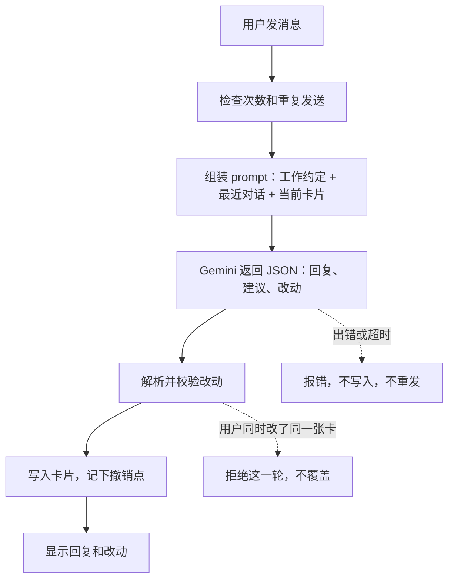
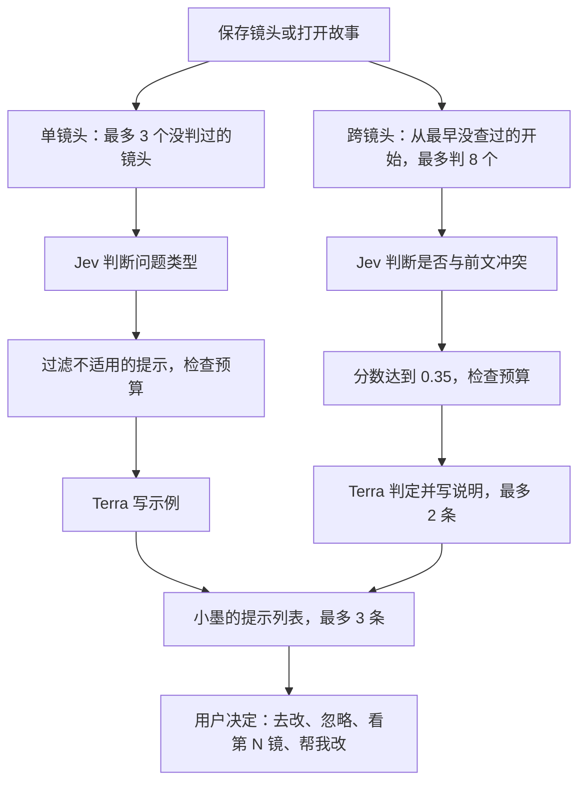
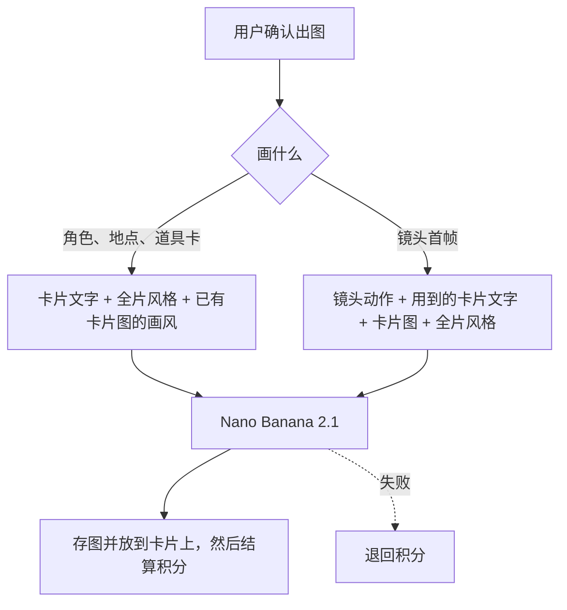
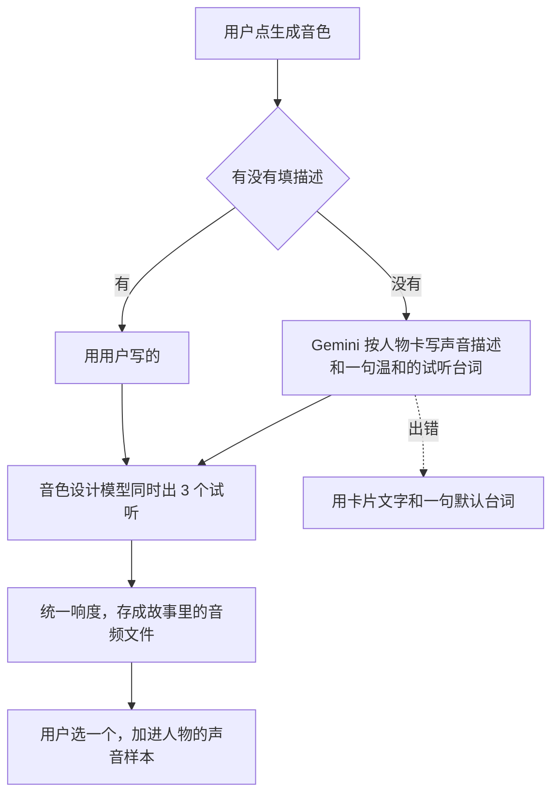
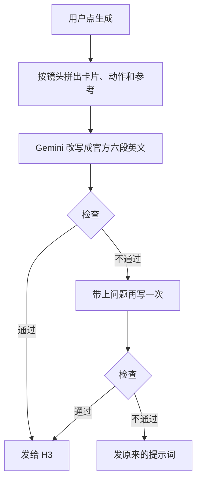

# AI 流程总览

这页说明每次调用模型时发生什么，以及用的是哪个 prompt 文件。prompt 都在 [`studio_platform/prompts/`](../studio_platform/prompts/)，直接打开就能读。改 prompt 只改文件，每次改动都有 Git 记录。

模型只给建议或方案，写入数据的永远是代码。

## 快速对话

用户在聊天框说一句话，或者贴一段剧本。



| 情况 | prompt 文件 |
|---|---|
| 工作约定和创作规则（思考档设为 low） | [`story_assistant.md`](../studio_platform/prompts/story_assistant.md) |
| 用户贴的是整段剧本 | [`story_script_note.md`](../studio_platform/prompts/story_script_note.md) |
| 从小墨打字（只能改卡片） | [`inky_typing_note.md`](../studio_platform/prompts/inky_typing_note.md)、[`inky_typing_focus.md`](../studio_platform/prompts/inky_typing_focus.md) |
| 用户抱怨已出的镜头（“太慢”“门对不上”“台词来得太晚”），附上最多 3 条对应修法 | [`inky_fix_note.md`](../studio_platform/prompts/inky_fix_note.md)、[`inky_fix_guide.md`](../studio_platform/prompts/inky_fix_guide.md) |
| 旧版自由对话 | [`quick_chat_default.md`](../studio_platform/prompts/quick_chat_default.md) |
| 自动起标题 | [`story_title.md`](../studio_platform/prompts/story_title.md) |
| 长镜头拆成连续片段 | [`script_windows.md`](../studio_platform/prompts/script_windows.md) |

### 看片问题修法（#1227）

故事里已有出好的镜头时，用户打字（小墨或快速对话，贴剧本除外）里出现某条修法的说法，就把匹配的修法（最多 3 条，匹配越长越靠前）附在这一轮的说明里，不多调一次模型。小墨先说原因，再给最便宜的修法：能改卡片文字的（`inky: edit`）先问用户，用户说好才改，可撤销；要用户自己动手的（`inky: point`）说清在哪改（换一条、剪辑里的速度/裁剪、尾帧、场景图）。重新生成要花积分，由用户自己点。

**加一条修法**：拍片技能（`inky-film` 的 `references/fix-guide.md`）学到新的坑后，在 [`inky_fix_guide.md`](../studio_platform/prompts/inky_fix_guide.md) 加一段 `## 名字`，四行 `when`（用户会说的话，中英文都要，用 `|` 分开）、`cause`、`fix`、`inky`（`point` 或 `edit: 小墨能改什么`）。用面向用户的话写：不写模型名、厂商、价格、内部编号或内部工具。再在 [`tests/test_inky_fix_guide.py`](../tests/test_inky_fix_guide.py) 的 `COMPLAINTS` 加一句用户会怎么说，跑这个测试。格式不对时应用启动就会报错。

## 小墨后台检查

保存镜头或打开故事后运行。失败不影响保存，也不会拦住生成。



| 步骤 | prompt 文件 |
|---|---|
| Jev 判断单个镜头 | [`inky_judge_questions.md`](../studio_platform/prompts/inky_judge_questions.md) |
| Terra 写示例 | [`inky_example.md`](../studio_platform/prompts/inky_example.md) |
| Jev 判断跨镜头冲突 | [`inky_continuity_question.md`](../studio_platform/prompts/inky_continuity_question.md) |
| Terra 写跨镜头说明 | [`inky_continuity_note.md`](../studio_platform/prompts/inky_continuity_note.md) |
| “帮我改”写草稿 | [`inky_rewrite.md`](../studio_platform/prompts/inky_rewrite.md)、[`inky_rewrite_guides.md`](../studio_platform/prompts/inky_rewrite_guides.md) |
| 判断上传的图属于哪张卡 | [`inky_upload_question.md`](../studio_platform/prompts/inky_upload_question.md) |

跨镜头提示没有“帮我改”，因为哪个镜头才是对的要由人决定。

## 出图

用户确认后才出图。图片放到卡片上之后才扣积分，失败就退回。



| 情况 | prompt 文件 |
|---|---|
| 角色、地点、道具卡 | [`card_picture_styles.md`](../studio_platform/prompts/card_picture_styles.md)；故事里已有卡片图时，第一张作为画风参考，见 [`card_picture_match.md`](../studio_platform/prompts/card_picture_match.md) |
| 镜头首帧 | [`first_frame.md`](../studio_platform/prompts/first_frame.md) |
| 用用户附上的照片当素材（#726） | [`card_picture_photo.md`](../studio_platform/prompts/card_picture_photo.md)，排在卡片图之后编号 |

某张卡片的图读不出来时，首帧照样画，只是这张卡只发文字。

快速创作里附上的照片（每条消息最多 4 张）会以缩小后的预览图随这一条消息发给 Gemini，助手能看到照片内容：可以把照片放到对应卡片上，也可以提议用照片当素材画一张新卡片图（最多 3 张，出图照常确认、照常扣积分）。照片读不出来时这一轮不发送，什么都不改。照片本身只存在故事素材里，不另存副本。

## 生成音色

人物卡上点"生成音色"。免费，每个账号每天最多 30 次。



| 情况 | prompt 文件 |
|---|---|
| 写声音描述和试听台词 | [`voice_brief.md`](../studio_platform/prompts/voice_brief.md) |

试听台词不能有威胁、打杀之类的话，因为音色设计模型会拒绝这类内容。

## 镜头提示词交给 H3 之前

H3 会把提示词里的中文当台词念，还会画成字幕（2026-11-07《三个身体的儿子》）。所以分镜镜头交给我们自己的 H3 机器之前，先改写成 MiniMax 官方的全参考格式：六段英文，参考图和音色按发送顺序编号成 `<Picture N>`、`<Audio N>`，台词原样留在 `<d>` 标签里。用户看到和编辑的还是自己的中文。



首尾帧模式（只挂首帧、尾帧或纯文字，没有别的参考）的镜头也改写（#1086），用官方首尾帧格式的三段：`integrated_multimodal_description`、`overall_soundscape`、`non_diegetic_music`。首帧编号成 `<Picture 1>`，有尾帧时接着编号；人物、场景、道具都写成英文的通用身份（"the old ferryman"），不写卡片上的中文名字。

检查：六段（首尾帧是三段）齐全且顺序对；台词标签外没有中文；每句台词一字不差、顺序不变、说话人编号还在；每张发出去的图和每段声音都被引用，没有引用没发的。同样的输入只改写一次，结果留在内存里。

| 情况 | prompt 文件 |
|---|---|
| 把镜头改写成 H3 全参考格式 | [`h3_reference_prompt.md`](../studio_platform/prompts/h3_reference_prompt.md) |
| 首尾帧镜头改写成 H3 官方首尾帧格式 | [`h3_frame_prompt.md`](../studio_platform/prompts/h3_frame_prompt.md) |

## 查真实记录

配置好 Langfuse 后，每次模型调用都有记录：Jev、Terra 和出图记录发送的内容，Gemini 记录最后一条消息。快速对话这一轮还会记录 `prompt` 文件名和 `prompt_version`，这个版本号是 prompt 全文的摘要，内容一改就会变。

### 记录里存了什么、存多久（#770，2026-11-10 核对）

- 发出去的内容：Gemini 只记最后一条消息，Jev、Terra 和出图记发送的请求；每段最多 6000 字，超出截断。图片只记"发了几张"，不存图本身；不记凭据；用户只记成不可反推的编号（`u_` 加摘要），不记名字或邮箱。
- 保存期限：Langfuse 项目目前**没有设置保存期限**（公开接口读到的项目信息里没有 retentionDays），记录会一直保留到手动删除。
- 注销账号：现在**不会**删除这个人在 Langfuse 里的记录（记录按上面的编号存）。
- 这两条要负责人决定：在 Langfuse 项目设置里定一个保存期限（可能需要付费套餐），以及注销账号时要不要按编号删掉记录（Langfuse 有删除记录的接口）。

## 固定评测集

改 prompt、换模型或改设置之前，先在同一批固定例子上跑一遍，结果在 Langfuse 的实验页里并排比较。

| 评测集（Langfuse dataset） | 来源 | 打分 |
|---|---|---|
| `story-chat-conversations` | [`tests/fixtures/story-chat/eval-conversations.json`](../tests/fixtures/story-chat/eval-conversations.json)，#756 的 20 段对话 | 计划能否套用、总时长是否接近要求、镜头数、每轮耗时 |
| `inky-text-cases` | [`tests/fixtures/inky/eval-cases.json`](../tests/fixtures/inky/eval-cases.json) 的文字题，#687 | Jev 的判断和人工标注是否一致、期望分 |

```
python tools/langfuse_evals.py upload                 # 把评测集放进 Langfuse，重复运行只更新同一批
python tools/langfuse_evals.py run story-chat --limit 2 --run-name 改了什么
python tools/langfuse_evals.py run inky --dry-run     # 只列出会跑哪些，不调用模型
```

- 走的是和线上一样的代码（同一份 prompt、解析和卡片规则），每次运行是 Langfuse 的一个实验，模型调用记在对应例子下面。
- 凭据只从中央目录读：Langfuse 用 `langfuse--inkseq`，模型用应用自己的 Gemini 和 TypeSafe 配置，不用 OpenRouter。
- 默认只跑 2 个例子；跑全集要明确加 `--limit`。
- 评测集只放编出来的例子，不放用户的故事或图片。
- 需要 `langfuse` 包（requirements.lock 里有，WSL 和应用环境都装了）。
- 上传图片的题（upload_card）还留在单元测试里，没有放进 Langfuse。
