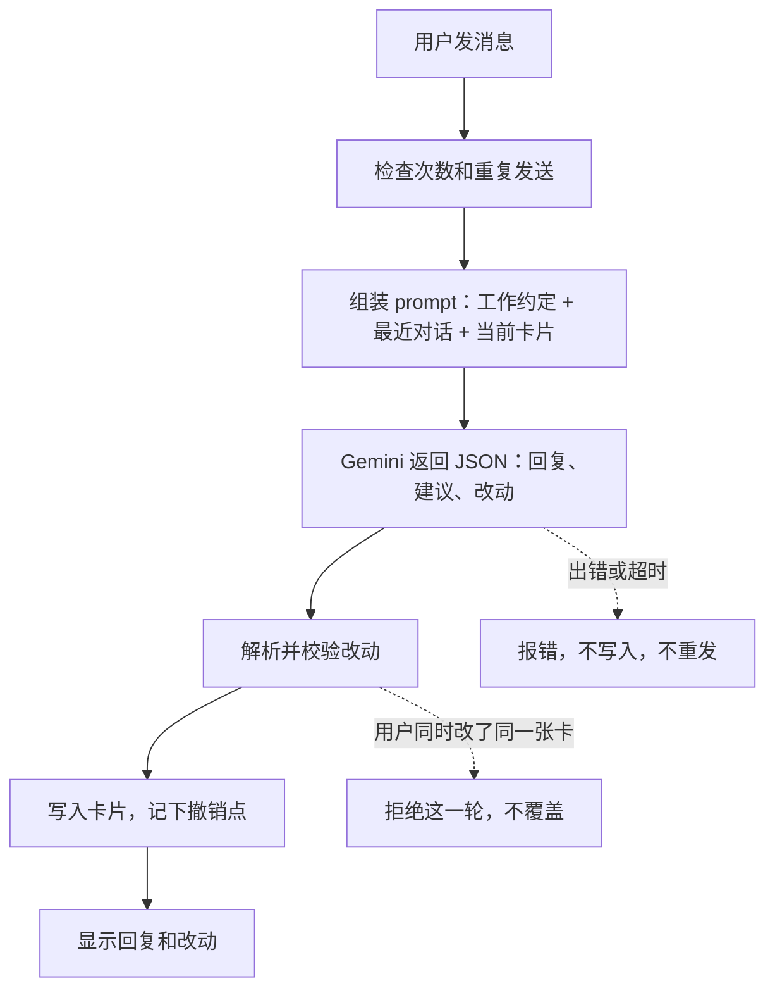
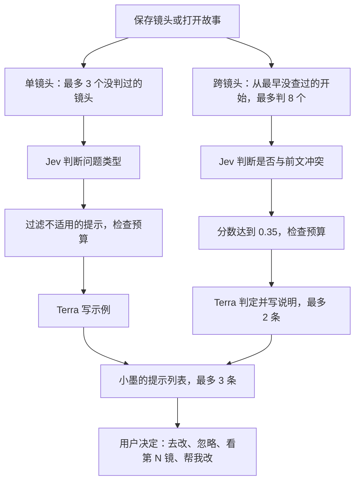
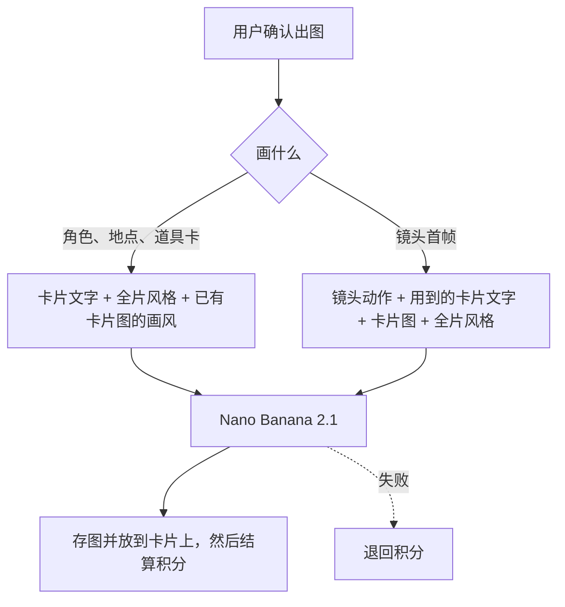
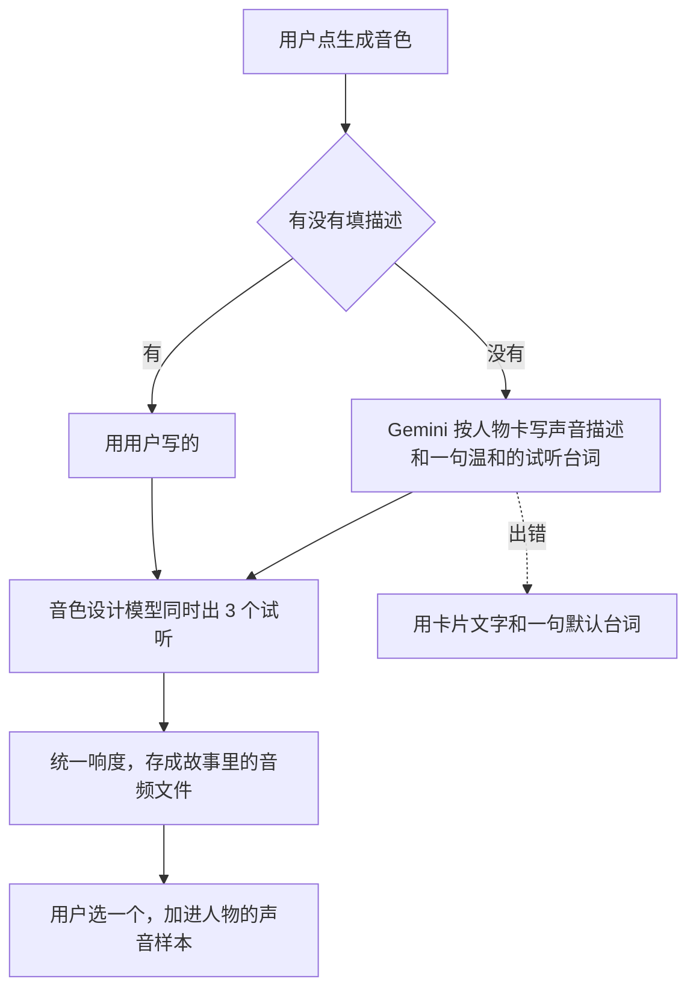

# AI 流程总览

这页说明每次调用模型时发生什么，以及用的是哪个 prompt 文件。prompt 都在 [`studio_platform/prompts/`](../studio_platform/prompts/)，直接打开就能读。改 prompt 只改文件，每次改动都有 Git 记录。

模型只给建议或方案，写入数据的永远是代码。

## 快速对话

用户在聊天框说一句话，或者贴一段剧本。

| 情况 | prompt 文件 |
|---|---|
| 工作约定和创作规则（思考档设为 low） | [`story_assistant.md`](../studio_platform/prompts/story_assistant.md) |
| 用户贴的是整段剧本 | [`story_script_note.md`](../studio_platform/prompts/story_script_note.md) |
| 从小墨打字（只能改卡片） | [`inky_typing_note.md`](../studio_platform/prompts/inky_typing_note.md)、[`inky_typing_focus.md`](../studio_platform/prompts/inky_typing_focus.md) |
| 旧版自由对话 | [`quick_chat_default.md`](../studio_platform/prompts/quick_chat_default.md) |
| 自动起标题 | [`story_title.md`](../studio_platform/prompts/story_title.md) |
| 长镜头拆成连续片段 | [`script_windows.md`](../studio_platform/prompts/script_windows.md) |

## 小墨后台检查

保存镜头或打开故事后运行。失败不影响保存，也不会拦住生成。

| 步骤 | prompt 文件 |
|---|---|
| Jev 判断单个镜头 | [`inky_judge_questions.md`](../studio_platform/prompts/inky_judge_questions.md) |
| Terra 写示例 | [`inky_example.md`](../studio_platform/prompts/inky_example.md) |
| Jev 判断跨镜头冲突 | [`inky_continuity_question.md`](../studio_platform/prompts/inky_continuity_question.md) |
| Terra 写跨镜头说明 | [`inky_continuity_note.md`](../studio_platform/prompts/inky_continuity_note.md) |
| “帮我改”写草稿 | [`inky_rewrite.md`](../studio_platform/prompts/inky_rewrite.md)、[`inky_rewrite_guides.md`](../studio_platform/prompts/inky_rewrite_guides.md) |
| 判断上传的图属于哪张卡 | [`inky_upload_question.md`](../studio_platform/prompts/inky_upload_question.md) |

跨镜头提示没有“帮我改”，因为哪个镜头才是对的要由人决定。

## 出图

用户确认后才出图。图片放到卡片上之后才扣积分，失败就退回。

| 情况 | prompt 文件 |
|---|---|
| 角色、地点、道具卡 | [`card_picture_styles.md`](../studio_platform/prompts/card_picture_styles.md)；故事里已有卡片图时，第一张作为画风参考，见 [`card_picture_match.md`](../studio_platform/prompts/card_picture_match.md) |
| 镜头首帧 | [`first_frame.md`](../studio_platform/prompts/first_frame.md) |

某张卡片的图读不出来时，首帧照样画，只是这张卡只发文字。

## 生成音色

人物卡上点"生成音色"。免费，每个账号每天最多 30 次。

| 情况 | prompt 文件 |
|---|---|
| 写声音描述和试听台词 | [`voice_brief.md`](../studio_platform/prompts/voice_brief.md) |

试听台词不能有威胁、打杀之类的话，因为音色设计模型会拒绝这类内容。

## 查真实记录

配置好 Langfuse 后，每次模型调用都有记录：Jev、Terra 和出图记录发送的内容，Gemini 记录最后一条消息。快速对话这一轮还会记录 `prompt` 文件名和 `prompt_version`，这个版本号是 prompt 全文的摘要，内容一改就会变。
