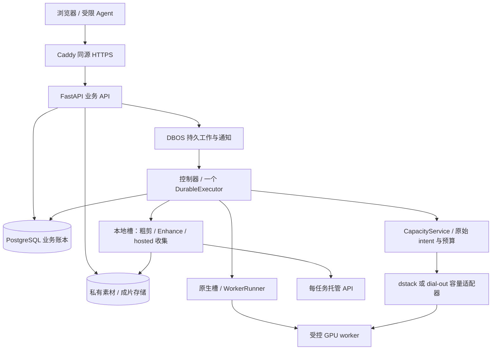

# Inkseq：当前代码、运行边界与未完成项

更新：2026-11-03，#899 重构批次。本文描述仓库中的执行路径；本地测试、合并和配置支持不等于生产验收。方向见 [架构基础](ARCHITECTURE-FOUNDATION.md)，供应商细节见 [供应商架构](PROVIDER-ARCHITECTURE.md)，调度规则见 [场景表](SCHEDULING-SCENARIOS.md)。旧的 2026-10-04 计划、供应商调研和性能数据是历史证据，不是当前默认值。

## 一套业务模型，按故障边界拆进程

Inkseq 的故事、镜头、素材、计划、任务和积分共用同一业务模型。浏览器和受限 Agent 通过业务 API 操作它，不能直接提交任意 ComfyUI 节点图、租机或持有供应商密钥。前端源在 `inkseq/inkseq-design/studio-app`，本仓库的 `inkseq-web/` 是发布同步副本。

生产入口为 `inkseq.com`；具体镜像、资源和启用项以环境发布记录为准。基础 Compose、迁移运行时和兼容工具并非一套相同的默认配置，不能从任一模板推断生产开关。

本地媒体槽目前仍与控制器共享进程/容器资源。`LocalSlotOwner` 的有限执行接口只是拆分准备，不是已上线的独立媒体服务。FFmpeg、输出归一化和槽初始化失败仍可能影响控制面，独立服务、内存限额和切换验证由 [#999](https://github.com/inkseq/h3-studio/issues/999) / [#813](https://github.com/inkseq/h3-studio/issues/813) 跟踪。

API、控制器、数据库和代理仍有同主机故障域；多个容器不等于高可用。数据库和告警迁移由各自事项管理，本文不宣称已采用托管 PostgreSQL、PITR 或自动故障接管。

## 状态与权限归属

| 边界 | 当前责任 | 不能据此推断 |
|---|---|---|
| 身份 / 会话 / Agent | `auth`、`identity`、账户会话及连接授权服务 | 请求体 owner、对象 key 和操作 ID 不是访问权限 |
| 创作 / 预检 / 接单 | `quick_chat`、故事服务、`generation_services`、`generation_admission`、`execution_policy` | 预检通过不代表已扣款、已分配机器或已生成 |
| 任务 / attempt / 租约 | 原始 `jobs`、`attempts`、fence 和 `WorkerControl` | 重启/唤醒不允许重新提交未知付费请求 |
| 持久编排 | DBOS 队列、outbox、一个控制器 executor | 不另建队列接管尚未确认的原操作 |
| 积分 / 预算 | 已接受报价、积分账本、供应商费用和容量预留 | 可服务容量与可能欠供应商的钱是独立事实 |
| GPU 容量 | `CapacityService` / `DstackCapacity`，原 `LedgerDstackStore` 和 intent | 空槽、终态、inventory 或注册行不授予租机权限 |
| 媒体 / 输出 | `AssetService`、对象存储、收集和校验服务 | 上游成功不等于已下载、验证或持久保存 |

事务仍由现有服务和数据库连接持有。重构不改 schema、迁移、计划指纹、报价、租约或已接单任务。表对象、异常类型及历史导入的兼容关系不能通过复制定义实现。

API 与控制器共用 `application_services` 的业务服务装配。控制器直接取得 `FilmExecution` 和账户工作流服务，不再调用 `api.create_app` 或注册 HTTP 路由；有限批次接单和源素材查询分别由 `BatchAdmission`、`RenderSources` 持有。HTTP 侧的 `FilmRuns` 保留创作入口和原有动态 helper，已接单执行仍使用同一账本、授权检查和任务身份。这消除了控制器到 HTTP 装配的依赖，但没有把本地媒体槽移出控制器。

## 代码职责与大小约束

`api.create_app` 保留装配、生命周期和身份中间件；`api_errors`、`asset_routes`、`generation_routes` 分别持有原错误映射、素材下载和生成/任务路由。路由顺序、OpenAPI、返回格式和测试注入入口不变。

`QuickChatService` 装配共享状态、卡片操作、执行和对话模块；`Repository` 装配文档、预算、任务和容量操作，所有模块复用同一组 schema 对象和原连接/事务。原生容量拆为请求契约、客户端、观测、账本、预览、注册与命令，费用义务不变。备份拆为 schema、文件验证和媒体覆盖，原协调器继续持有数据库检查、快照和清单发布顺序。

`tools/check_maintainability.py` 重新强制 1,500 行上限，基线中的超大模块归零；已有复杂函数仍记录在基线，只允许减少，不能通过改大基线绕过。文件变小不代表事务、成本和故障恢复已经简化：这些行为继续由原测试覆盖。边界图按真实职责记录拆分后的依赖，不把预算、任务和容量模块归入“共享基础设施”来隐藏依赖。

## 两类供应商

原生执行池租用机器运行我们的 worker，承担启动、闲置、停止和未知实例义务；托管 API 按原任务提交一次，承担重复提交和未知结果风险。二者不能合成一个掩盖费用差异的状态机。

`providers/registry.py` 分开定义容量 backend / 账务 provider，以及执行 backend。派生集合保留各自用途：CPU 槽不因此成为可租赁 GPU，RunPod Serverless 的 backend 名不改写历史账务 provider。`providers/hosted_models.py` 定义托管模型和链；新增供应商仍需要适配器、能力契约及测试，不能只加注册行就启用。

原生容量接口为 `plan/start/observe/stop/reconcile`；`observe_terminal` 保持单独的狭窄操作。共享 dial-out 生命周期复用 create-only journal、原始查询、身份和状态投影。Modal dial-out 与 RunPod Serverless 是并列适配器，不再用供应商继承复用。run spec、journal 和历史收据格式仍保留，尚非完全供应商无关的存储格式。

托管适配器共用小型 `VendorHTTP` 传输，保留 `transport=` 注入、大小限制、拒绝重定向和不自动重试。一次 EveryFrame 余额观测供原有不同消费者投影，刷新节奏和失败语义保持不变；未知余额不是零费用证据。

GPU 连接由实际 profile 指定，dial-out 与旧 SSH 路径仍有不同消费者。旧 `modal-v1`、账务 provider `modal` 和持久字段 `hatchet-v1` 尚有历史/运行读取者；保留兼容身份不代表 Hatchet 服务仍是当前队列。删除条件见 [#987](https://github.com/inkseq/h3-studio/issues/987)。

## 调度、费用与未知结果

规则表与场景文档对应；租赁资格、停止证明和事务仍由原操作方决定。规则表不替代预算、权限、原始状态或承诺费用检查，也未引入规则引擎。

合法 rebind 保留已接受的 `credit_quote`、`budget_account_ids`、`capacity_policy_snapshot`、`deployment_profile_id` 及指纹，只改原有路由字段。用户按 tier 付一次，一个 job 同时只有一个活跃 attempt，一个 intent 只绑定一个 backend。

提交响应丢失、供应商状态未知、取消未确认和账单未确认分别保留原证据。未知结果先查原操作，不自动重投、换供应商或租第二台；收集失败恢复原输出。确认停止和费用结清分别处理，不能用一个终态同时释放二者。

本轮保留已有边界差异：五次阈值统计提交/预留而非五个成功成片，四十任务阈值逐次重新计算，已知费用的 deadline fallback 可能留下仍在计费的原供应商任务。见 [现状说明](https://github.com/inkseq/h3-studio/issues/899#issuecomment-6578212797)，这些不是本轮悄悄修正的策略。

`everyframe_enabled` 在进程启动时确定：显式 `INKSEQ_EVERYFRAME_ENABLED=1/0` 优先，未显式设置时才按既有凭据文件是否存在取默认值。路由在 dispatch 时读取，不进入 `Settings` 的早期路由选择。配置、库存、余额与是否实际启用须分别核对，本文不列易失的线上上限。

## 媒体与恢复

数据库保存稳定 asset/artifact ID、来源、对象 key、大小和哈希，不把过期签名 URL 当资产身份。下载前检查归属；上传原件、模型副本、显示副本和最终成片具有不同引用角色。衍生失败不覆盖或删除原件。

存储绑定须与已有资产一致。Local / S3 协议适配存在，不代表改环境变量就能迁移历史对象；生产权限及可恢复性只能由相应环境的原始记录证明。

API 媒体准入、工具超时和 Linux 子进程资源限制继续保留，但不是整个容器的 OOM 保证。#999 的独立媒体服务不得靠猜测控制器限额、扩大预算或增加另一个 DBOS executor 来完成。

备份契约见 [BACKUP-RECOVERY.zh-CN.md](BACKUP-RECOVERY.zh-CN.md)。数据库快照、媒体覆盖、离机保存和实际恢复是独立证据。覆盖按引用角色判断：可从原件重建的 display/preview/thumb 缺失是预期不完整；缺失上传/生成原件仍告警，共享原件引用不能被衍生角色掩盖。未知操作读原记录，不回放。本轮不修媒体、不运行生产备份或恢复。

## 发布、验证和剩余工作

API、控制器及相关角色使用同一平台镜像。静态网页有独立发布路径，但须先满足 API/worker 兼容关系，顺序见 [DEVELOPMENT-RELEASE.zh-CN.md](../DEVELOPMENT-RELEASE.zh-CN.md)。不能以本地源码、另一个 SHA 的测试或热补丁代替接受过的制品。

现有主机入口先委托迁移维护流程；旧 release body 仍服务文档中的首次 bootstrap，不能整段删除。`worker_compatibility` 仍是版本 1 制品必需字段，[核查与反例](https://github.com/inkseq/h3-studio/issues/815#issuecomment-6579032673) 解释了保留原因。#990 的导入扫描器没有合并；控制器到 `api.create_app` 的依赖已由上述共享服务装配消除，worker 指纹仍保留原有较宽范围。进一步缩小发布范围需要独立验证实际依赖及兼容关系，不能把本次代码拆分当成已完成的发布隔离。

准确离线命令见 [AGENTS.md](../AGENTS.md)：锁定依赖、Ubuntu / Python 3.12、Node 22.23.4、FFmpeg 和 CJK 字体。数据库并发与 DBOS 恢复使用一次性本地 PostgreSQL，vendor cassette 回放既有答案，不录制、不调用付费服务。测试仅证明覆盖的代码路径，不证明生产费用、吞吐或恢复时长。

剩余事项：#999 / #813 媒体隔离；#812 其余跨域依赖；#815 真实发布拆分及旧首发流程；#987 历史执行路径退役。数据库、告警和前端类型仍由 Claude 负责。本轮没有新增队列、微服务集群、会员功能或未测量的扩容承诺。
