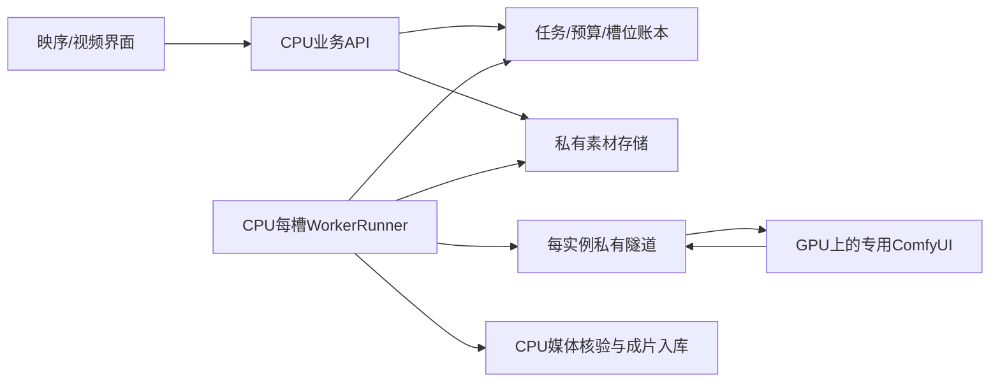

# CPU控制面与多槽执行

2026-11-02 更新：`studio_platform/fleet.py` 保留槽配置与单次 runner 构造。持续执行由 `dstack_controller` 的 DBOS `DurableSlots` 管理；旧 `FleetSupervisor`、fleet CLI 与非 DBOS 子进程循环已退役。本文的 SSH/Comfy 配置仍用于现存兼容路径，不表示新增部署应使用旧 supervisor。

## 拓扑

WorkerRunner保留在CPU控制面成立，无需先开发GPU直连任务数据库的HTTP网关。CPU节点运行API、账本、每槽worker、素材读取/规范化及FFmpeg输出核验；GPU实例只运行受限ComfyUI。CPU通过逐实例独立SSH loopback隧道访问Comfy，或使用已核实私有HTTPS网关。SSH钥匙、API key、数据库与存储凭据均留在CPU的受权运行环境，fleet manifest不存这些值，GPU不接收它们。



前端只使用业务API，不连接原生Comfy端口，不传任意node图或供应商凭据。此结构增加CPU与GPU之间素材/结果传输以及CPU转码负担；后续应测并发CPU、网络和存储成本，不能只看GPU推理时间。fleet不宣称建立好了私网或验收了实际模型。

## 公共Python接口

- `SlotConfig(spec:WorkerSpec,enabled=False,endpoint='',allowed_origins=(),comfy_revision='',confirmed_idle=False)`：精确实例/物理卡/pool/model/config/recipe绑定。真实origin不得含认证、query或path；HTTP仅loopback，远程为明确HTTPS。allowed_origins必须只有完全相符origin；实际Comfy revision为40位小写commit。重复GPU、worker或endpoint拒绝。
- `FleetConfig(work_dir,slots=(),enabled=False,max_children=0,shutdown_grace_s=210)`：显式绝对工作目录，最大32子进程。enabled时至少一个明确启用槽且不超max_children；CPU模拟与真实槽不混入同一fleet。
- `read_config(absolute_path)`：仅受信操作员JSON（Linux禁止组/其他用户写），最多256KiB，拒绝未支持字段。`fingerprint()`覆盖所有manifest值；此数据接口仍保留，已不启动子进程。
- `slot_runner(...)`：给 DBOS 创建有界 runner 上下文；槽租约与 fence 由 `DurableSlots` 管理。关闭上下文不等于供应商机器已停止或费用已结算。
- `run_slot(config,worker_id,settings,repository=None,store_factory=...,backend_factory=None,runner_factory=WorkerRunner,once=True)`：只执行一个阶段，factory用于隔离验收；`once=False` 明确拒绝。Settings的backend与generation_enabled必须明确匹配。真实首次/失联空闲恢复需confirmed_idle声明及当前private `/queue`确认为空；不能靠历史benchmark或进程活着假定就绪。已有未结束current_job只核对原attempt。

每槽独立`work_dir/<worker_id>`；数据库和store沿用CPU Settings，同一API/worker必须指向同一账本和私有objects。model/config/recipe的登记精确匹配不构成模型权重的密码学证明，实际模型/硬件资格须独立验收并由执行策略引用。

R2使用与现有API相同的S3StorageConfig与中央load_storage_credentials入口；不复制加载器或.env。Linux/AWS必须另有受权可用的运行时凭据适配，Windows DPAPI库不能因为挂载文件就当作可在AWS解密。其他远端store需明确注入已审阅adapter，不回退默认AWS账户。本轮只验证本地/fake存储；单PUT限制100MiB仍适用，大输出由ArtifactWriter使用已有持久multipart receipt/配额链分片并核验。分片代码与离线测试不代表512MiB全部输出已在远端实际验收。

## 新提交的资格门槛

`WorkerRunner(...submission_guard=callable,stop_requested=callable)`：真实Comfy默认未提供guard时拒绝新提交。准备前与紧邻begin_submission前各核验一次，CLI/fleet接`ExecutionPolicies.submission_allowed(job)`，重新检查真实策略/model/config/hash、资格与报价期限，但不把已预留预算再计算一次。检查失败在确未提交时失败并释放预算，error_code为execution_policy_unavailable_before_submission。running/unknown/collecting恢复沿用原attempt，不因新报价/资格变化重新提交，也不会阻止合法成片收集。Mock为明确CPU模拟例外，始终标识SIMULATION。

Fleet只运行被任务计划指定的池；它不会自动将5090、96GB卡、B200互换或套用另一配置。现执行策略只对明确已验收pool/config准入；多GPU登记不代表不同硬件配置都获得资格，不自动改变模型、画质、参数或价格。

## 配置与退出

受信manifest的最小安全形态（仍需使用当前主机的真实绝对目录）为：

```json
{"version":1,"work_dir":"/data/fleet","enabled":false,"max_children":0,"shutdown_grace_s":210,"slots":[]}
```

每slot字段为worker_id、pool、provider、instance_id、physical_gpu_ids数组、recipe_ids数组、model_id、configuration_id、backend、enabled、endpoint、allowed_origins数组、comfy_revision、confirmed_idle。字段名不能加API key、DB URL、SSH key或密码；凭据使用Settings已有FILE/中央加载入口。

旧 `python -m studio_platform.fleet`、`--request-drain` 和 `--slot` 命令已移除，不能用它们启动或排空服务。部署入口是 `python -m studio_platform.dstack_controller`，要求 `generation_queue=dbos`；原 PostgreSQL 数据库、任务记录和历史 `hatchet-v1` 路由标识仍保留。

DBOS 停止槽时先等活动阶段退出，再关闭上下文并释放自己的 fence。未退出或关闭失败不删除槽状态，也不宣称机器已空闲。drain 停止新 claim 并保留 current_job、预算和上游 ID；过期或 unknown 不因进程存活而自动复活。

停止 CPU 服务、drain/retire 或删除目录都不会停止 GPU 供应商计费；云实例停止与费用核对仍属于原供应商控制面。旧 supervisor 的 PID 文件和 drain 标记不再是当前服务的控制接口，历史文件不得作为杀进程或释放预算的依据。
# CPU 章节合成槽补充

`cpu-render` 可与真实 `comfy-worker` 共用 CPU 控制主机，但模拟 mock 仍独立。CPU SlotConfig 没有 endpoint、allowed origins 或 Comfy revision；明确 `provider=local-cpu`、`model_id=sixnine-chapter-roughcut-v1`、`recipe_ids=(chapter-roughcut-v1,)`、`physical_gpu_ids=()`。新作业 `render.version=3` 精确匹配 `configuration_id=cpu-render-v3`，默认无字幕，可显式烧录已经确认的字幕；历史 v1/v2 收尾 worker 必须分别使用 `cpu-render-v1`/`cpu-render-v2`，三种配置不能互接。`platform_cpu_slots` 将一个 CPU instance ID 固定给一个 worker，不能用不同 worker ID 无限重复注册；同实例升级须先以原身份和工作目录收完旧任务再退役，或使用另一 CPU 实例。CPU 不占 GPU 全局 gate 或 registered_devices。

CPU 子进程需要独立 `Settings.render_enabled=True`，不复用 H3 generation 开关。它使用相同 auth/预算/recipe/submission guard、隔离 workdir 和 drain 机制；CPU 生成不默认联网。章节范围 1..14400 帧/24fps/≤600秒，偶数尺寸 256..1280、像素≤921600；完整 collection decode 的 timeout≤1800秒，阻塞媒体阶段续租。只给当前 CPU attempt 发取消，GPU running 取消仍遵循原 Comfy 安全契约。

fleet内建CPU backend使用固定noto-cjk字体profile；有字幕作业需要Linux镜像中已配置的Noto Sans CJK SC/libass环境，worker登记不代替字体验收。Windows的已有微软雅黑测试引用仅由独立render_cli显式选择windows-yahei，fleet manifest不接受用户字体路径，也不会自动复制/下载字体。v3生产资格应包含实际中文烧录验收。
